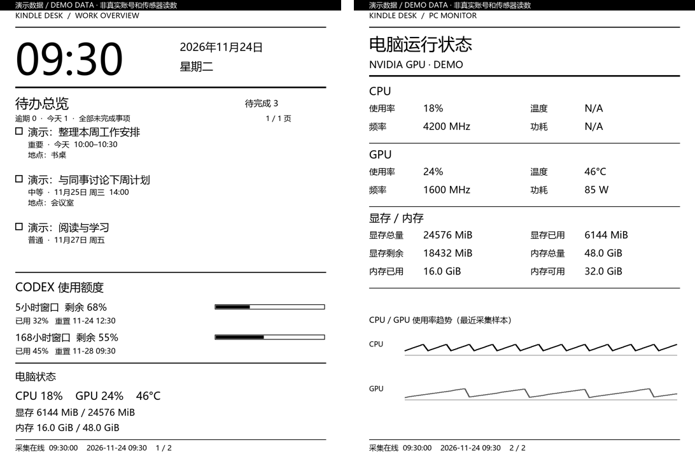

# Kindle Desk Dashboard · Kindle 桌面信息屏

**让闲置 Kindle 成为 Windows 桌上的工作信息屏。一根 USB 线，完成供电与有线同步。**

中文界面、本地待办、电脑状态、Codex 使用额度；电脑离线后，Kindle 继续显示时钟。Windows 负责采集与排版，Kindle 负责显示，运行时不需要 Wi-Fi、树莓派或额外付费 API。

> **v0.2.0 社区测试版**：目前实测设备为 Kindle Paperwhite 3（第七代），固件 5.16.2.1.1。需要已经完成适配越狱及 USBNetwork 配置的设备。本项目不包含一键越狱，不保证其他代际或固件可直接使用。连续 24 小时运行和长期残影观察尚未完成。



*上图由实际渲染器生成，所有事项、硬件读数和额度均为标注的演示数据，不是用户的真实信息。*

## 能显示什么

| 页面 | 内容 |
|---|---|
| 工作总览 | 时间、日期、星期、全部未完成待办、事项时间与地点、优先级、Codex 额度、电脑简要状态 |
| 电脑监控 | CPU 使用率与频率、GPU 使用率/温度/功耗/频率、显存、内存及黑白趋势图 |

- 待办保存在本机 SQLite，可新增、修改、删除、完成；未来事项也会显示，每组最多 3 条，在管理页切换分组。
- 输入分为事项、日期、开始/结束时间、地点、优先级；日期快捷选择今天、明天、后天、自选日期或不设日期。
- Codex 通过官方本地 App Server 查询额度窗口、使用/剩余比例和重置时间；额度与 Token 统计分开。接口未返回的信息显示 N/A，不推算订阅额度。
- 硬件数据来自 psutil、Windows 接口与 NVIDIA SMI；CPU 温度/功耗当前显示 N/A。**不采集磁盘容量、磁盘读写速度和网络流量。**
- 管理端仅监听 `127.0.0.1`，提供页面预览、手动刷新、两页切换、待办管理、采集/同步状态和日志。
- 采集与屏幕刷新分离：默认硬件 15 秒、Codex 5 分钟、画面 60 秒；待办变化触发更新。全屏清屏频率可调。

## 已验证环境

| 项目 | 实测环境与限制 |
|---|---|
| 主机 | Windows 11 x64，Python 3.14.5 |
| Kindle | Paperwhite 3，第七代，固件 5.16.2.1.1，Micro-USB |
| 屏幕 | 1072 × 1448，8-bit 灰度 PNG，系统 `eips` |
| 通信 | USBNetwork 0.22.N-r19297、Windows RNDIS、系统 OpenSSH/SCP |
| 硬件 | Core Ultra 7 270K Plus、RTX 5090 D v2 24GB、48GB 内存 |

其他 NVIDIA 显卡、其他 Python 版本及其他 Kindle 型号暂未实机验收。USB 地址当前固定为 Windows `192.168.15.201/24`、Kindle `192.168.15.244`，不支持在管理页任意改址。子网冲突时工具会停止，避免改动其他网络。

## 快速开始：先在电脑预览

安装 [Python](https://www.python.org/downloads/windows/)（实测 3.14.5 x64），并启用 Windows OpenSSH 客户端。下载源码 ZIP 后解压，或克隆仓库。在项目目录打开普通 PowerShell：

```powershell
python -m venv .venv
.\.venv\Scripts\python.exe -m pip install -r requirements.txt
.\.venv\Scripts\python.exe scripts\run_dashboard.py
```

不需要激活虚拟环境，不需要修改 PowerShell 执行策略。之后可双击 `Start-Dashboard.cmd`。

浏览器会打开本地管理页。首选端口为 `8766`，若不可用，Windows 会选择另一个本地端口并保存。**以启动器打开的地址为准，不需要修改防火墙或猜端口。** 关闭浏览器后后台仍运行。首次启动默认不连接 Kindle，可以先添加示例待办并查看两页预览。

## 接入 Kindle

完整步骤见 [安装与 USB 接入](docs/INSTALL.md)，先确认以下前提：

1. 核实设备确为上述已验证型号与固件，已按原维护者资料完成越狱和 USBNetwork 安装。
2. Windows 已识别 `USB Ethernet/RNDIS Gadget` 网络适配器，Kindle USB 地址为 `.244`；USB 大容量存储与网络模式不能假定同时工作。
3. 主机 USB 接口设为 `.201/24`，不要设置网关或把 Wi-Fi 地址改成这个地址。
4. 完成 SSH 密钥认证和测试 PNG 的人工目视确认，然后部署显示客户端。

在普通 PowerShell 中执行设备显示验证（会生成项目专用密钥、追加公钥并绘制测试图）：

```powershell
.\.venv\Scripts\python.exe scripts\kindle_display_probe.py
```

确认图片方向、边界与中文正常后，部署本项目客户端：

```powershell
.\.venv\Scripts\python.exe scripts\run_dashboard.py --setup-kindle
```

部署会将自己的脚本写到 `/mnt/us/kdd`，临时接管显示并暂停 Kindle 阅读界面；正常停止后恢复。没有安装 Kindle 开机启动项。请先阅读安装说明再执行，不能拿本项目替代机型兼容性核验。

## Codex 额度

在同一 Windows 用户下安装并登录官方 Codex 客户端/CLI；本项目优先发现本机 `codex`，独立启动官方 App Server，执行只读的 `account/read` 与 `account/rateLimits/read`。

- 不需要 `OPENAI_API_KEY`，不发起模型推理或额外付费 API 请求。
- 不读取或复制 `auth.json`，不上传账号凭据，不调用内部网页额度接口。
- 登录、订阅和官方额度接口仍需要相应网络连接；“USB 不依赖 Wi-Fi”不代表 Codex 在线数据能脱网更新。
- 未安装、未登录、认证失效、超时或没有额度数据时显示明确状态，不影响待办、硬件和时钟。

详见 [Codex 数据源](docs/CODEX.md)。本项目不是 Amazon 或 OpenAI 官方产品，也不提供额外 Codex 额度。

## 关机、开机和退出

| 情况 | 行为 |
|---|---|
| Windows 关机或 USB 断开 | 客户端仍运行且 Kindle 有电时，约 90 秒后切到离线时钟，每分钟更新 |
| Windows 再次登录 | 安装了本项目登录启动项时，后台恢复；USB 可用、Kindle 客户端仍运行时恢复同步 |
| 更换 USB 插口 | Windows 可能创建新网络接口，需要重新核验固定地址；见故障排除 |
| Kindle 自己重启或耗尽电量 | 当前没有设备开机自动运行；USB 网络恢复后需重新执行 `--setup-kindle` |

安装 Windows **当前用户登录启动**：双击 `Install-Autostart.cmd`。这不是系统登录前运行的 Windows 服务。移动项目或删除虚拟环境前先卸载启动项。

停止 Kindle 客户端、恢复阅读界面：

```powershell
.\.venv\Scripts\python.exe scripts\run_dashboard.py --stop-kindle
```

卸载本项目登录启动项并请求停止后台：双击 `Uninstall-Dashboard.cmd`。它保留本地待办、代码、SSH 密钥、USBNetwork 和 RNDIS 驱动；删除数据应由用户自行另行处理。

## 数据、安全和配置

- `data/`：待办、自动迁移备份、帧图片和每位用户自行生成的 SSH 密钥。
- `config/settings.json`：首次运行创建。参考 [配置样例](config/settings.example.json)；手工编辑前先停止程序，不要复制他人的本机配置。
- `logs/` 与 `docs/evidence/`：本机诊断文件，不上传 Git。
- 中文字体默认读取 Windows 自带微软雅黑，本仓库不分发微软字体。
- 请勿把数据、私钥、完整序列号或未脱敏日志提交到 Issues。详见 [安全说明](SECURITY.md)。

## 开发与测试

```powershell
.\.venv\Scripts\python.exe -m pip install -r requirements-dev.txt
.\.venv\Scripts\python.exe -m unittest discover -s tests -p "test_*.py" -v
```

自动测试覆盖待办迁移与保存、中文灰度渲染、官方额度协议、模块故障隔离、本地 API 边界、USB 路由与换口保护、后台启动及端口回退。实机结果、未通过或未执行的项目见 [测试记录](docs/TESTING.md)。演示图片可用 `scripts/render_demo.py` 重新生成，不访问设备或账号。

```text
app/       数据采集、待办、渲染、本地管理 API、USB 传输
kindle/    设备显示客户端
scripts/   启动、停止、登录启动和 USB 诊断
tests/     自动测试
docs/      中文安装、架构、故障排除和测试说明
```

## 参与和反馈

欢迎提交中文 Issue，说明设备代际、固件、Windows 版本、项目版本、复现步骤和脱敏后的错误。优先补充其他硬件的实测记录、安装可复现性和断线恢复问题；不以增加功能数量为目标。贡献约定见 [CONTRIBUTING.md](CONTRIBUTING.md)。

## 开源与致谢

自主代码采用 [MIT](LICENSE)，允许商用与修改，需保留许可及版权声明。第三方依赖各自保留原许可证，见 [THIRD_PARTY_NOTICES.md](THIRD_PARTY_NOTICES.md)。

实现研究参考了 kindle-syswatch、paperwhite-weather、kindle-dashboard、pad-dash、headroom-kindle、trmnl-koreader、KindleVibe。参考不等于复制；没有明确许可证的候选仓库只研究技术实现，其下载源码未并入本仓库。来源和取舍见 [开源研究记录](docs/OPEN_SOURCE_AUDIT.md)。越狱工具、USBNetwork、MRPI、驱动、字体及账号凭据不包含在本项目发行物中。
