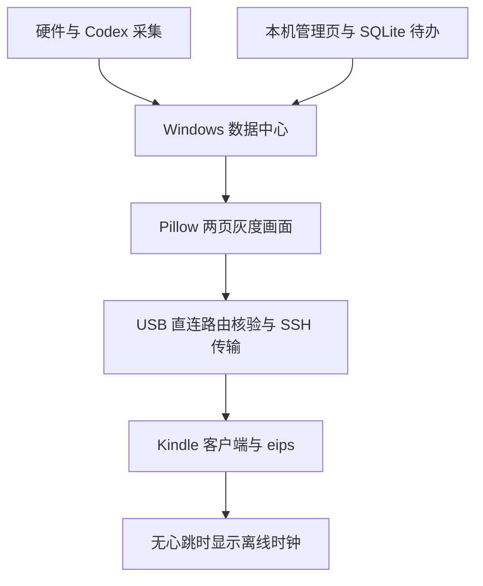

# 系统结构

Windows 使用 Python + FastAPI + Pillow + SQLite，设备使用 shell + 系统 eips，图像经 Windows 系统 OpenSSH/SCP 通过 USBNetwork 发送。管理 HTTP 仅供本机浏览器，不经过 USB 网络开放服务。

硬件、Codex、渲染和设备发送分别工作。数据源超时后显示状态或 N/A，不阻止其他模块。默认硬件采样 15 秒、Codex 300 秒、画面 60 秒，主机心跳与屏幕重绘分开。离线时钟依赖设备本身继续运行。

PNG 使用 1072×1448、L 模式，SHA256 核验后原子替换画面与状态文件。固定远端操作不接收网页提交的 shell 命令。任务内容作为文本显示，写接口校验本地 Host、Origin 与启动时生成的 token。

当前没有云端存储、遥测、外部日历依赖或 Windows 系统服务。登录自动运行使用当前用户的 Run 项；Kindle 开机自动启动尚未实现。
